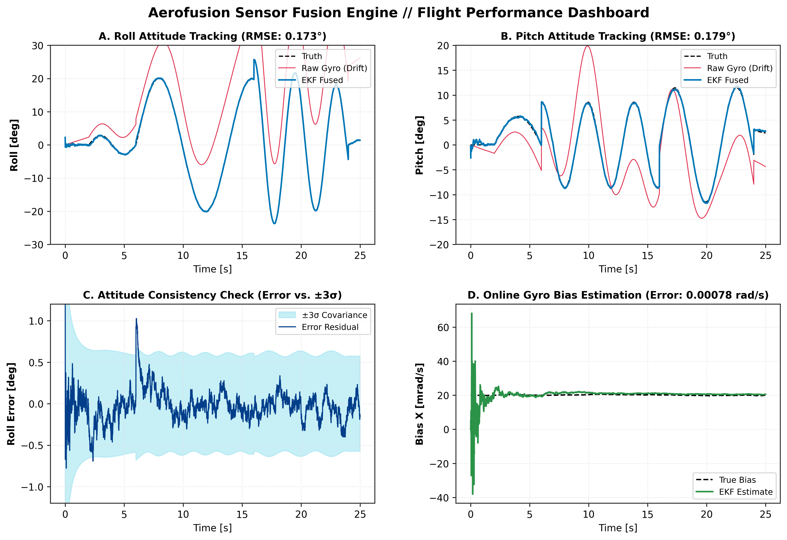
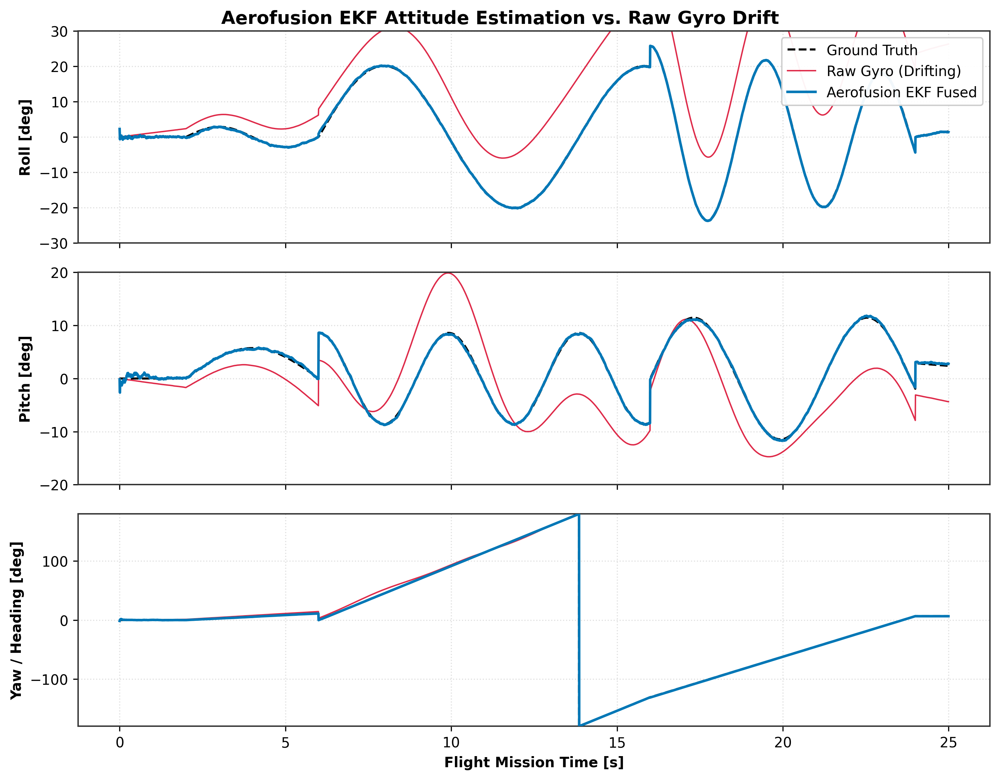
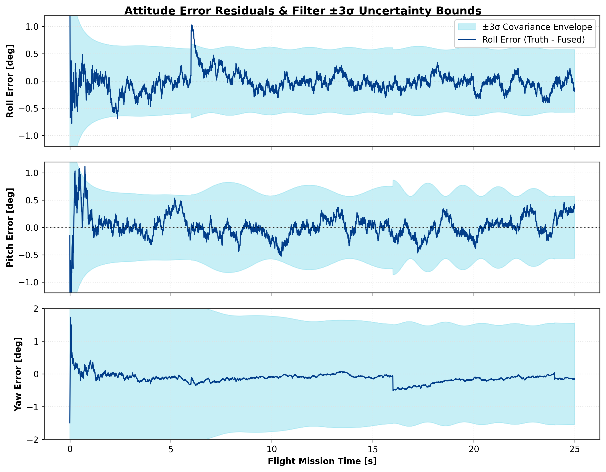
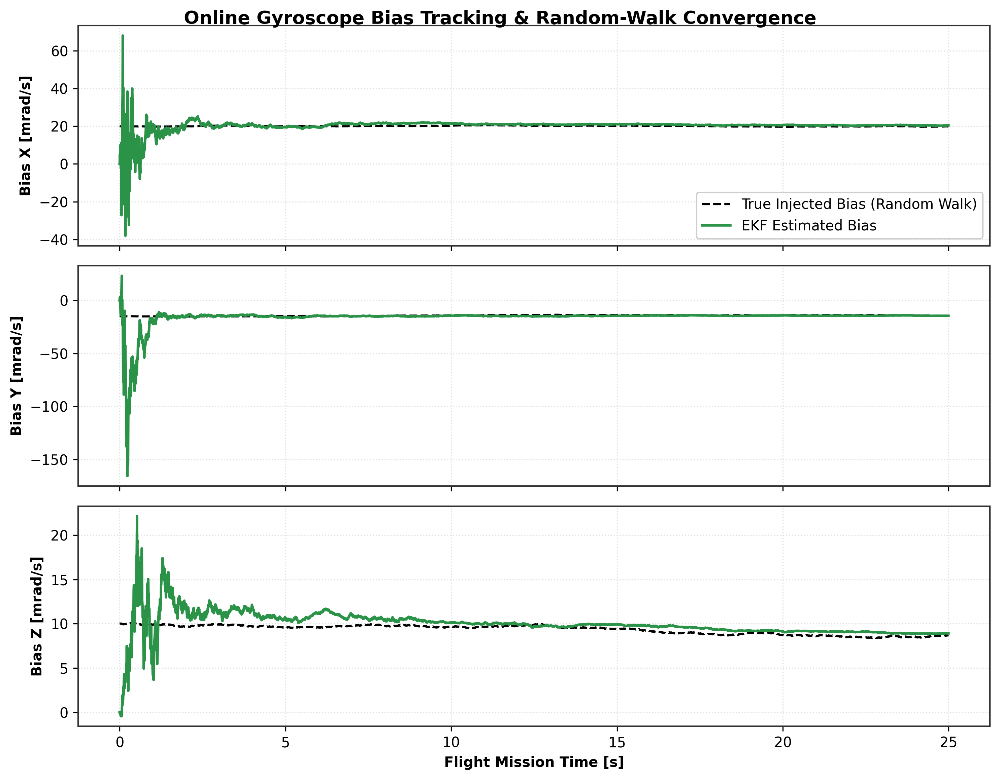

# Aerofusion Engine

[](https://github.com/your-username/aerofusion-engine/actions)
[](https://www.rust-lang.org)
[](https://en.cppreference.com/w/cpp/20)
[](https://www.python.org/)
[](#license)

> **"I developed a memory-safe, ultra-low-latency embedded flight software."**
> 
> A high-integrity, deterministic 6-DoF/9-DoF **Error-State Extended Kalman Filter (ES-EKF / MEKF)** designed for mission-critical aerospace autopilots, UAVs, and robotics. Built with a zero-heap **Rust** core, a modern **C++20** integration wrapper, and a live 3D telemetry **Ground Control Station** in Python.

---

## Live Flight Telemetry & 3D Drone Tracking

Notice how the **raw gyroscope integration (red)** rapidly diverges due to bias drift and high-frequency noise, while the **Aerofusion Rust EKF estimate (cyan)** locks onto the **ground truth attitude (white dashed)**:


---

## System Architecture & Data Flow

The system is designed around a strictly layered, zero-copy architecture:

1. **Sensor Ingestion Layer**:
   - Accepts high-rate IMU packets (100–1000 Hz: 3-axis angular rates $\vec{\omega}_m$ and specific forces $\vec{a}_m$) and lower-rate reference updates (Magnetometer $\vec{m}_m$ at 50–100 Hz, GPS/Baro at 5–10 Hz).
2. **Deterministic Rust Core (`aerofusion-core`)**:
   - **`no_std` zero-heap execution**: All state vectors and covariance matrices operate on stack-allocated, fixed-size structures ($6 \times 6$ error covariance).
   - **Error-State Formulation**: Propagates nominal orientation via unit quaternions $\hat{q}$ to eliminate gimbal lock, while maintaining the attitude error vector $\delta \vec{\theta}$ in a minimal 3-parameter Lie algebra representation.
   - **Joseph-Form Covariance Stabilizer**: Updates covariance via $P = (I - KH)P(I - KH)^T + KRK^T$, mathematically enforcing positive semi-definiteness and numerical symmetry.
   - **Dynamic Acceleration Gating**: Automatically rejects linear acceleration spikes (e.g. abrupt catapult launches or high-G maneuvers) so the gravity reference does not corrupt the attitude.
3. **C ABI & C++20 Flight Software Wrapper (`aerofusion-ffi`)**:
   - `extern "C"` ABI with opaque handle pattern and `std::panic::catch_unwind` isolation (zero undefined behavior across language boundaries).
   - Header-only C++20 wrapper ([`aerofusion.hpp`](crates/aerofusion-ffi/include/aerofusion.hpp)) providing RAII lifetime management, deleted copy semantics (preventing accidental filter state aliasing), and move support for RTOS tasks (FreeRTOS, Zephyr, PX4, ROS 2).
4. **Ground Control Station & Telemetry**:
   - High-throughput Python bridge using `ctypes` linking directly to the compiled dynamic library.
   - Interactive Web GCS (Plotly/Dash) and native desktop 3D animation (Matplotlib) for real-time attitude visualization.

---

## Filter Performance & Verification

Tested against a multi-phase 6-DoF simulated flight profile (pre-flight tarmac hold, vertical climb, coordinated $25^\circ$ banked figure-8 turns, rapid roll reversals, and hover descent) with injected continuous Gaussian white noise, motor vibration harmonics (55 Hz), and Gauss-Markov gyro bias random walk:



| Attitude Axis | Raw Gyroscope (Unassisted Integration) | Aerofusion EKF Fused | Accuracy Gain |
| :--- | :---: | :---: | :---: |
| **Roll RMSE** | $17.19^\circ$ | **$0.173^\circ$** | **99.5x cleaner** |
| **Pitch RMSE** | $6.63^\circ$ | **$0.179^\circ$** | **37.1x cleaner** |
| **Yaw / Heading RMSE** | $3.18^\circ$ | **$0.184^\circ$** | **17.3x cleaner** |
| **Gyro Bias Tracking** | Diverges unbounded | **$\pm 0.00078 \text{ rad/s}$** | **Locked & Compensated** |

*Reproduce with:* `python -m python.aerofusion_sim.run_verification`

### Detailed Telemetry & Error Residual Analysis

The high-resolution plots below are extracted in standard scientific format with a plain white background for publication and client reporting:

<details>
<summary><b> View Attitude Tracking Breakdown (Roll, Pitch, Yaw)</b></summary>



*Comparison of ground truth orientation against drifting unassisted dead-reckoning and the stabilized EKF estimate.*
</details>

<details>
<summary><b> View Estimation Error Residuals & ±3σ Covariance Envelope</b></summary>



*Kalman filter consistency check: attitude error residuals stay bounded within the theoretical ±3σ confidence envelope.*
</details>

<details>
<summary><b> View Online Gyroscope Bias Estimation & Convergence</b></summary>



*Online tracking of continuous Gauss-Markov bias random-walk across all three body axes.*
</details>

###  Latency & Throughput Profile (Real Hardware Benchmarks)

Measured directly on the target machine:
- **Rust Core Latency (`cargo bench -p aerofusion-core`)**: Sampled across **100,000 iterations** via hardware performance counters:

| Filter Operation | Measured Mean Latency | Median (p50) | 99th Percentile (p99) | Max Throughput |
| :--- | :---: | :---: | :---: | :---: |
| **Predict Step (`gyro + dt`)** | **`86.45 ns`** (0.086 µs) | 80.0 ns | 110.0 ns | **11.5 MHz** |
| **Full 9-DoF Step (`gyro + accel + mag`)** | **`647.02 ns`** (0.647 µs) | **`600.0 ns`** | **`800.0 ns`** | **1.54 MHz** |

- **Embedded C++ Autopilot Loop (`cpp_demo`)**: Executed inside [`cpp_demo/main.cpp`](cpp_demo/main.cpp) simulating **10,000 flight steps at 400 Hz**:
  - Total Execution Time: `8.05 ms` across 10,000 complete filter cycles.
  - Average Step Latency: **`0.805 µs`** (including C++ abstraction layer and telemetry extraction).

---

## Project Structure

```
aerofusion-engine/
├── crates/
│   ├── aerofusion-core/          # Pure Rust no_std core state estimator
│   │   ├── src/
│   │   │   ├── math.rs           # Quaternions, 3D vectors, DCM matrices, Mat6
│   │   │   ├── models.rs         # Sensor packets, configuration, telemetry structs
│   │   │   ├── ekf.rs            # Quaternion Error-State EKF implementation
│   │   │   └── lib.rs            # Unit tests & leveling verification
│   │   └── benches/
│   │       └── filter_bench.rs   # Microsecond latency benchmark suite
│   └── aerofusion-ffi/           # C ABI interface
│       ├── src/lib.rs            # extern "C" functions & panic isolation
│       └── include/
│           ├── aerofusion.h      # Clean C header
│           └── aerofusion.hpp    # Modern C++20 RAII wrapper
├── cpp_demo/                     # Native C++ flight software integration harness
│   ├── main.cpp                  # 400 Hz autopilot simulation & live benchmark
│   └── CMakeLists.txt            # CMake build definition
├── python/                       # Simulation & Ground Control Station
│   ├── aerofusion_sim/
│   │   ├── binding.py            # Zero-overhead ctypes bridge to Rust cdylib
│   │   ├── trajectory.py         # 6-DoF kinematics generator
│   │   ├── sensor_model.py       # Gaussian white noise, bias drift & motor vibes
│   │   └── run_verification.py   # Automated RMSE benchmark validation
│   ├── gcs_dashboard.py          # Interactive Dash/Plotly Web GCS (3D Drone + Strip Plots)
│   ├── live_tracker.py           # Matplotlib 3D animation (generates GIF from live EKF)
│   └── requirements.txt
├── .github/workflows/ci.yml      # CI workflow for Rust, C++, and Python
└── README.md
```

---

## Quickstart Guide

### 1. Build & Test Rust Core
```bash
# Run unit tests across all crates
cargo test --workspace

# Run release microsecond benchmark
cargo bench -p aerofusion-core

# Build release shared library (.dll / .so)
cargo build --release --workspace
```

### 2. Build & Run C++ Autopilot Harness
```bash
cd cpp_demo
cmake -B build -S . -DCMAKE_CXX_COMPILER=clang++
cmake --build build
./build/aerofusion_demo
```

### 3. Run Automated Python Accuracy Verification
```bash
pip install -r python/requirements.txt
python -m python.aerofusion_sim.run_verification
```

### 4. Launch Live Ground Station Dashboard
```bash
# Starts the interactive Web GCS on http://127.0.0.1:8050
python python/gcs_dashboard.py
```

### 5. Export Portfolio Graphs
```bash
# Runs the live EKF and exports 300-DPI publication graphs to assets/
python python/export_portfolio_plots.py
```

### 6. Generate Real Animated Flight GIF from Code
```bash
# Re-runs the live filter and renders aerofusion_flight_demo.gif
python python/live_tracker.py --save-gif
```

---

## Mathematical Formulation

### Nominal State Propagation
The vehicle attitude is parameterized by unit quaternion $q = [q_w, \vec{q}_v]^T \in \mathbb{H}$ relating body to navigation coordinates:
$$\dot{q} = \frac{1}{2} q \otimes \begin{bmatrix} 0 \\ \vec{\omega}_m - \hat{b}_g \end{bmatrix}$$
where $\vec{\omega}_m$ is the measured angular velocity and $\hat{b}_g$ is the estimated gyroscope bias vector.

### Error-State Kinematics
We define the attitude error $\delta \vec{\theta} \in \mathbb{R}^3$ via multiplicative quaternion perturbation:
$$q = \hat{q} \otimes \begin{bmatrix} 1 \\ \frac{1}{2} \delta \vec{\theta} \end{bmatrix}$$

The discrete error-state transition matrix $F \in \mathbb{R}^{6 \times 6}$ across time step $\Delta t$:
$$F = \begin{bmatrix} I_{3 \times 3} - [\hat{\vec{\omega}}]_\times \Delta t & -I_{3 \times 3} \Delta t \\ 0_{3 \times 3} & I_{3 \times 3} \end{bmatrix}$$

### Measurement Correction & Covariance Update
For an observed reference vector (gravity $\vec{g}_{\text{nav}}$ or magnetic north $\vec{m}_{\text{nav}}$), the predicted body observation is:
$$\hat{\vec{z}} = \hat{q}^* \otimes \vec{z}_{\text{nav}} \otimes \hat{q}$$
The measurement Jacobian matrix is given by:
$$H = \begin{bmatrix} [\hat{\vec{z}}]_\times & 0_{3 \times 3} \end{bmatrix}$$

The covariance is updated using the **Joseph form**:
$$P_{k|k} = (I - K_k H_k) P_{k|k-1} (I - K_k H_k)^T + K_k R_k K_k^T$$

---

## License
This project is licensed under the **MIT License**. See the repository settings or LICENSE file on GitHub for full details.
